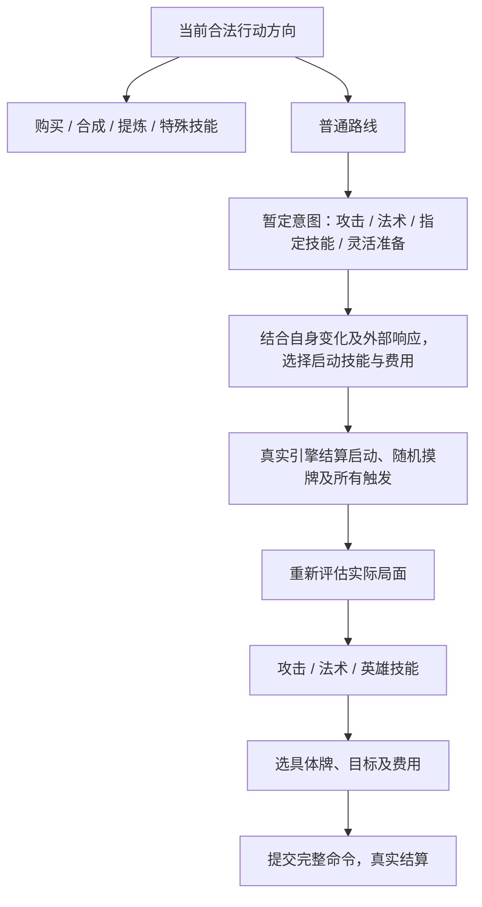

# AI 决策入口：方向、启动意图与逐步选牌

2026-11-05。本文说明本批实现，不表示新网络已经完成训练或强度验收。

## 采用的结构

保留每张牌的独立实体、属性、命格和独有技，但模型不再先看到所有完整动作的排列组合。共用策略网络在当前层的合法选项中打分，再进入被选中的分支。价值网络仍使用独立参数，奖励仍只有终局团队胜负。

实现中的普通路线命名为 `activate`。这个选项的摘要包含当前可行的普通行动、可用牌和目标，以及本人的潜在启动技能；先选路线并不意味着模型在不知道后续可能性的情况下盲选。启动后的普通行动才细分为 `attack`、`spell` 和 `heroSkill`。购买、合成、提炼与特殊技能保持自己的合法时机。

“攻击、提炼、施法”是本次实现的操作方向。“追求士气胜利、积攒资源、支援队友”是更长期的目的，本批没有另写一个固定规则把这些战略目的锁死。

## 启动必须考虑其他角色

暂定意图用于回答“这次启动准备做什么”，不锁定某张牌。`flexible` 表示准备通过摸牌、资源或形态改变获得行动机会；不能因为当前没有攻击牌，就删除启动后可能攻击的路线。

启动影响分为三类：

| 类别 | 表示与处理 |
| --- | --- |
| 自己能确定的变化 | 已知费用、公开形态变化，以及发动技能会产生的事件 |
| 其他角色可选择的响应 | 响应者、技能、触发条件、公开资源与可能变化；不能当作一定发动 |
| 依赖未知牌或后续随机结果的变化 | 标注未知条件；不读取他人暗牌或未来牌序 |

首批接通魔剑士的暗影凝聚：若选择发动，会对自己造成1点法术伤害。蝶舞者拥有茧时，其毒粉可能在实际法术伤害为1的时点响应。因此，启动估计不能只算“自己摸1、进入形态”，还要看到毒粉带来的变化。治疗先于毒粉的时点结算；实际伤害已变成0时，不应继续假设毒粉加伤。

公开接口 `describeActivationInteractions` 返回事件和潜在响应，不执行规则，不提供规则AI分数，也不虚构响应概率。网络收到对应实体、条件和关联关系。规则AI另用“不响应／毒粉响应”的有限场景估值，保留基准和范围；当前等权场景只是启发式，不能解释成蝶舞有50%概率响应。镜花水月及凋零依赖茧牌内容，当前只描述潜在条件，没有假装完整模拟。

英雄自己的声明放在各自的 `src/heroes/<英雄>/ai.js`。这只是第一条明确接入的外部连锁，其他英雄未声明的影响不等于不存在，也不表示72英雄的启动已经完成精确搜索。潜在启动订阅的摘要不执行技能 `filter`，所以也不表示每项技能此刻都能发动；真正发动与支付仍由引擎检查。

启动意图只对本座位的网络可见。实际启动完成后清除意图和预留，按真实手牌、资源及状态重新选择。启动中得到更好的牌可以改变原计划；胜利、无法行动与强制换牌等仍由共用规则处理。

## 爆牌与多牌费用

12张手牌需要弃6张时，不建立924个六张组合。模型逐张选出待弃牌，下一次同时看到原手牌和已选集合，选择6张后一次性提交给引擎。

候选数量依次为 `12、11、10、9、8、7`，共评估57个单步候选。选中的牌仍在原区域，没有提前触发弃牌、公开事件、封印或士气变化。最后统一结算。这保留了组合判断：例如已选了一张水牌后，另一张水牌的价值可以随当前已选集合变化，并不是对所有牌算一次固定分数再取最低6张。

这仍是条件选择，不能保证找到全局最优的六张组合。后续可以在必要处加入少量候选集合搜索，本批不增加搜索树。

有 `validSets` 的规则选择只保留至少还能完成一个合法集合的前缀。可选技能可在未选牌时放弃；允许可变数量时显式选择完成。固定数量选齐后结束内部选择，但整个过程不改变网页交互的确认规则。

英雄主动技能按“技能→模式→费用牌→目标数量→依次选目标”展开，仅生成所选分支。费用通常是无序集合，最后使用固定顺序提交；目标顺序仍保留，因为先影响甲后影响乙可能改变规则结果。普通攻击与法术按“牌→目标”选择。已有较小的响应、数字和简单技能询问继续直接评分，不为统一形式强行拆开。

## 观测与训练契约

分层决策最初使用 `entities-v5`，2026-11-09观测补全后源码使用 `entities-v6`。结构化实体编码、共享策略网络、候选评分和参数独立的价值网络承载以下信息：

- 当前选择阶段、方向及意图；已选牌/目标与待完成数量。
- 每个方向关联的可用牌、技能、目标摘要，引用可见实体，不携带未选分支的完整命令列表。
- 启动的潜在事件与外部响应条件，包括是否可选、是否依赖未知信息、是否已经建模。

每个子决策进入训练轨迹，但没有新增子步骤奖励或时间折扣。最终只根据团队胜负学习。规则教师可以把原来的完整命令映射成这棵树上的路径，作为起步示例；模型并不被教师锁定具体牌或后续行动。教师采集与陪练执行完整教师路径；暂不支持模型偏离该路径后，继续拿同一个无条件教师命令给后续步骤贴标签。

训练驱动使用 `decisionMode: "hierarchical-v1"`，每个子步骤记录阶段、候选哈希和选择索引。残局恢复重放同一协议，前缀仍不计入本次学习。旧v4模型、词表及旧扁平轨迹不能直接混入新版训练。历史扁平枚举保留用于旧接口与比较；当前v5采集和worker直接进入新树，不再先枚举全部命令再分组。

## 代码入口与边界

| 文件 | 职责 |
| --- | --- |
| `training/decision-space.mjs` | 逐层候选与合法前缀，最终产出一个引擎命令 |
| `training/driver.mjs` | 驱动子决策、记录重放、只提交最终命令 |
| `training/teacher.mjs` | 完整教师命令到分层路径的映射 |
| `training/entity/observation.mjs` | 可见实体、阶段、摘要与启动交互编码 |
| `src/ai/activation-interactions.js` | 公开启动交互声明接口 |
| `src/heroes/shared/ai/wave-three/activation-preview.js` | 有限启动场景的规则AI估值 |
| `src/turn.js` | 启动意图的生命周期；实际流程仍由规则触发器执行 |

本批减少的是训练候选的组合展开。共用引擎的复杂技能合法性检查仍有 `cardSets` 搜索；带自定义 `cardsFilter` 的费用也可能搜索组合判断是否存在可行后缀。规则教师本身还会调用自己的行动排序。因此不能宣称所有组合复杂度都已消除，也不能由57比924直接推导完整训练快了多少倍。分层增加推理次数，实际吞吐仍需在新模型训练时测量。

本次不修改浏览器操作方式、不替换线上模型、不把短跑通过当成强度提升。验证仅保留通用合同：合法分支、逐张选牌不提前结算、实体隐私、重放和模型接口；不固定某个英雄必须采用某条打法。

## 本批验证记录

- `npm test`：148项核心规则通过；`npm run test:ai`：14项通过，替换原有分组测试，没有增加测试总数。
- 12局完整教师采集覆盖全部72英雄；另72场各至多18回合的短跑完成8,759次子决策，无异常。这不是全英雄强度或全部技能分支覆盖证明。
- 真实回合边界恢复重放190次决策，完整状态哈希一致。
- CPU上2次参数更新、恢复后追加1次更新通过；v5检查点恢复与原始/稀疏编码推理兼容通过，旧v4加载被明确拒绝。
- 两局各5回合的worker短跑完成66次网络决策，当前/另一模型分别处理43/23次；截断不产生虚构终局奖励。

短跑材料在本机 `/tmp/xingbei-v5-decision-final/`，只用于管线验证。没有产生可宣称胜率的新模型，也没有启动长期训练任务。
