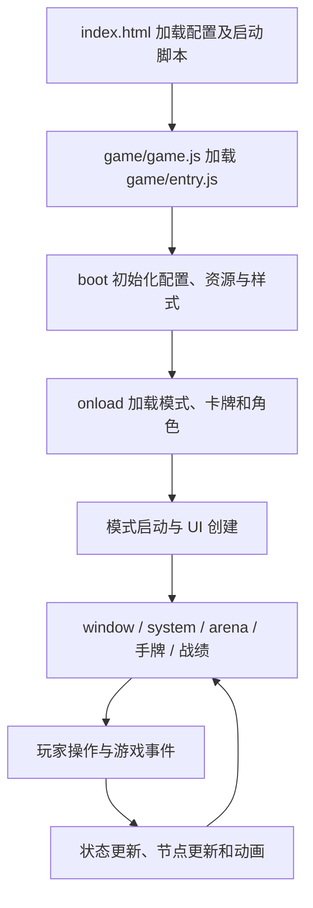

# 前端还原分析与阶段计划

更新日期：2026-10-10。

本文是阶段计划。P0 已开始执行，首次启动、选角、四人开局、选牌和菜单的首批运行证据见 [P0 基准报告](frontend-baseline-p0.md)。其余场景及还原实施状态以该报告和后续任务记录为准。

10月已实施P1基础开发入口、P2布局及P3/P4现有组件和交互，验证与遗留差异见 [本次还原报告](frontend-restoration-2026-10-10.md)。阶段表继续作为完整还原范围，不把局部实施或回归测试当作全部视觉通过。

同日后续按用户要求增加图片/字体本地缓存、战绩星石总上限5个，合成和提炼改为满足条件后手动确认，手牌整理改为先攻击/法术再系别。材料确认规则以本次用户要求为准；具体回归及截图复现差异同步记录在本次还原报告。

应战随后补充选择对手期间切换合法应战牌和选中牌上浮，不加入确认步骤；专项验证及当前测试版本0.1.2见本次还原报告。

历史测试版本0.1.3补充魔弹发起/传递的唯一目标点选，增加连坐传递隔离场景，统一引擎同步/异步传递规则；当时正式四人对局为间位。验证记录见本次还原报告。

## 1. 目标及完成口径

在更精简的实现上复现原项目用户可见的页面、布局、素材、交互状态和动态反馈。现有零依赖 Web 与 CLI 共用规则引擎的结构继续保留。

分两个交付里程碑，但不缩减最终目标：

- **M1：默认外观下的 3v3 六人对局还原。** 覆盖当前引擎已支持功能，以及相应弹窗、动态反馈、桌面与窄屏表现。
- **M2：前端全量范围闭环。** 在 M1 基础上逐页还原启动、模式选择、选角、菜单、图鉴、教程、联机等原版实际可达页面及其状态。默认之外的主题、布局和人数也进入范围清单，不能无声遗漏。

“页面展示通过”“交互通过”“真实业务接入通过”分别记录。联机服务、角色技能或其他规则尚未实现时，可以用明确标识的开发场景还原界面，但业务接入保持待完成，不能把模拟成功当成真实完成。

原项目残留的不可达代码不自动成为需求；是否可达，需要源码入口和运行证据。确需排除的原版能力写入范围清单并说明原因，不能由实现者自行将其从“完全还原”中删去。

## 2. 原项目的前端如何构成

下面所有原版路径以 `../../xingbei-1.6.7-source/` 为根。

### 2.1 启动与页面创建



`index.html` 主要负责引导加载，不包含完整对局页面。`noname/ui/create/index.js` 的 `arena()` 创建 `#window`、`#system`、`#arena`；`me()` 创建手牌区域；玩家节点继续委托给 `lib.element.Player.build()`。因此，单独复制 HTML 无法还原页面。

模式、卡牌、角色代码和引擎共同驱动 UI。战绩是一个具体例子：`create.zhanJi()` 创建容器，`UI.updateShiQiInfo()` 根据双方士气、战绩星石、星杯和玩家阵营生成表格，`noname/game/index.js` 等位置调用更新。阅读 UI 时需要跨文件追踪“创建—更新—触发”。

### 2.2 样式、素材和布局计算

| 层 | 源码证据 | 对还原的影响 |
| --- | --- | --- |
| 基础样式 | `layout/default/layout.css` | 字体、公共节点、日志和基础定位 |
| 布局继承 | `layout/nova/layout.css` 导入 `layout/newlayout/layout.css` | nova 不是独立样式表，必须追踪继承 |
| 主题 | `theme/music/style.css` | 背景纹理、圆角、阴影、颜色与状态效果 |
| 专项样式 | `theme/style/card/`、`cardback/`、`hp/` 和 `layout/others/` | 牌面、牌背、标记、弹窗和技能呈现 |
| 运行时配置 | `noname/init/index.js`、`noname/init/onload.js` | 加载样式、注入样式、读取用户自定义外观 |
| 布局算法 | `noname/ui/index.js` | 手牌重叠、滚动、缩放及部分座位计算 |
| 素材与字体 | `image/`、`theme/`、`font/` | 相同图片之外，还需相同字体、裁切和纹理 |

最终级联顺序要在浏览器中记录，不能将上表顺序直接当作实际 CSS 优先级。

已确认的关键细节：

- 默认配置为 music + nova，默认模式为 tutorial；运行时存储的配置可能覆盖默认值。
- nova 四人布局中，1、2、3 号相对座位分别位于右侧、上方中央和左侧。原版用 `data-position`，9月新版按玩家 ID 设置 `data-seat` 并摆在四角，需要明确“玩家身份 → 当前视角的相对座位”映射。
- `updatehl()` 根据手牌容器宽度和牌数计算横向位移，空间不足时重叠或滚动，并调整牌上文字。9月新版的 flex 间距和横向滚动不等价。
- `updated()` 和 `updatez()` 涉及设备缩放及整个 body 的尺寸、transform；窄屏不是简单地把各面板纵向堆叠。
- 原版战绩使用带星石图片和阵营高亮的表格；9月新版是自定义红蓝信息卡片。
- 原版同时有 `#arenalog` 和 `#historybar` 等日志/历史相关节点，需按实际配置确认展示关系，不能直接用新版右侧文本日志替代所有历史交互。
- 字体通过 `@font-face` 动态注册，引用 `font/*.woff2`。9月新版服务器没有相应字体路由，后续需要按实际资源清单扩展。

### 2.3 技术栈与杂乱代码的边界

主对局界面以原生 DOM 创建、节点方法、CSS 及事件调度为核心，没有看到它依赖现代应用框架构建页面的必要性。

源码虽有 `game/vue.esm-browser.js`、`noname/ui/create/menu/new.js` 和 `.vue` 模板，但当前 `noname/ui/create/index.js` 导入的是 `menu/index.js` 及 `menu/pages/`。不能因存在 Vue 文件就将原版归类为 Vue 应用；另一路菜单是否可达，需要进一步运行验证。

平台兼容、更新、联机、其他模式、第三方库和星杯逻辑混在同一源码树中。迁移单位应为“用户能看到和操作的功能”，按需抽取行为，避免整包复制旧引擎。

### 2.4 9月首次采集时新版的主要差距

| 区域 | 新版当前情况 | 后续处理 |
| --- | --- | --- |
| 页面结构 | 标题栏、红蓝卡片、四角玩家、中央回合块、底部手牌、右侧日志 | 按原版节点和几何关系重建对应区域 |
| CSS | `style.css` 加 `original-theme.css` 覆盖 | 逐区域替换并移除失效规则，避免继续无限覆盖 |
| 玩家和卡牌 | 简化头像面板、整张卡图与底部文字 | 还原原版节点分层、信息位置和状态样式 |
| 操作流程 | `web/app.js` 同时负责渲染、异步选择、AI 回合 | 分开呈现和交互状态，以便单独复现与调试 |
| 随机和时间 | 使用 `Date.now()` 初始化，AI 有自动延迟 | 增加仅用于开发的固定场景、暂停及单步能力 |
| 其他页面 | 当前 Web 入口直接开启对局 | 建立页面清单，分批接入导航和真实能力 |

## 3. 每个阶段都要能看、能复现、能定位

以下是调试方案。固定场景、暂停/单步、重置及状态导出已接入；可复现范围及截图波动以10月报告为准。

### 3.1 开发场景入口

在正常游戏外提供显式开发入口，例如 `/web/dev.html?scene=hand-6`，与正常游戏使用同一套渲染模块。开发数据、暂停按钮、测量覆盖层不得混入正式游戏界面。

每个场景记录：场景 ID、原版到达步骤、主题/布局/配置、视口、DPR、浏览器及版本、缩放、字体加载结果、玩家视角、状态快照、操作序列。固定随机种子之外还要固定牌序和输入；单靠 seed 无法保证异步时序一致。

支持重置场景、暂停 AI、单步推进和导出调试信息。调试信息至少包含当前回合、当前交互阶段、选中卡牌、合法目标、待处理选择和事件序列。重置时取消旧回合和未完成选择，避免旧异步任务污染新场景。

### 3.2 视觉与交互证据

- 同一场景保存原版图、新版图、差异图和关键区域的几何测量。建议按 `阶段/场景/视口/` 组织，不覆盖已有基准。
- 静态截图等待图片、字体和布局稳定，冻结瞬时动画；动画用独立的事件序列和录像验证。
- 关键区域记录 x/y/宽/高、字体、裁切、层叠关系；能点击的位置也要验证，不能仅看截图。
- 建议几何初始容差为关键边界不超过 1 CSS px，P0 根据原版自身重复截图的波动校准；文字内容、素材路径、座位对应和交互结果必须一致。
- 不预设“全屏相似度 95% 即通过”。大背景会掩盖局部错误；分区检查，像素差只作辅助，字体抗锯齿等环境噪声单独说明，不能屏蔽真实差异。
- 范围矩阵、任务状态和证据一起更新。进度采用“已通过场景数 / 当前范围场景总数”，新增范围同步改变分母，不凭代码量估算完成百分比。

### 3.3 最小场景集合

| ID | 场景 | 核心检查 |
| --- | --- | --- |
| S01 | 固定六人开局 | 骨架、座位、当前视角和初始信息 |
| S02 | 0、1、4、6 张手牌及爆牌临时状态 | 空态、排列、重叠、文字、滚动 |
| S03 | 选择/取消卡牌，合法/非法目标 | 样式、点击范围和状态切换 |
| S04 | 购买、合成、提炼 | 资源变化、材料选择、操作可用性 |
| S05 | 攻击及应战链 | 提示、响应、目标变化和连续选择 |
| S06 | 魔弹、虚弱、中毒、圣盾 | 标记、提示和对应已支持流程 |
| S07 | 爆牌选择 | 多选数量、确认条件、提交后状态 |
| S08 | 回合推进及历史信息 | 当前行动者、提示、日志和历史入口 |
| S09 | 结束、重新开始 | 结束展示、旧任务取消和新局一致性 |
| S10 | 缩放、横竖屏及触摸 | 布局分支、坐标映射、遮挡和点击 |

这些是新版需要覆盖的结果，不预先认定原版也采用新版同名弹窗。P0 必须记录原版实际交互路径，再确定组件形式。

## 4. 阶段任务与验收门槛

依赖主线：P0 → P1 → P2 → P3 → P4 → P5 → P6 → M1；P7 的页面盘点随 P0 开始、实现依赖可复用组件；P8 在全范围闭环后形成 M2。每阶段的每个子项应单独可演示，避免积累成一次大改。

| 阶段 | 任务编号与实施内容 | 可观察交付 | 通过条件 |
| --- | --- | --- | --- |
| **P0 建立原版基准** | P0.1 验证原版与新版启动、记录环境与加载错误；P0.2 盘点可达页面、外观配置与依赖；P0.3 捕获 S01–S10 的原版状态、DOM、样式和素材清单 | 可重复进入的原版对局；范围矩阵；基准截图和来源映射 | 默认 3v3 六人的主要状态可复现；缺失资源、入口故障和未覆盖页面逐项登记，不能用猜测替代 |
| **P1 建立调试场景** | P1.1 从 app.js 提取共享渲染入口和界面状态；P1.2 固定场景、重置、暂停与单步；P1.3 状态导出、截图和测量流程 | 用场景 ID 直接进入指定状态；看到输入、状态和画面对应关系 | S01、S03、S07 可重复重置得到相同静态画面；不影响正常 Web/CLI；旧异步任务不串局 |
| **P2 还原桌面骨架** | P2.1 背景、字体、画布与坐标；P2.2 系统栏、对局区、自身区、战绩和历史区域锚点；P2.3 清理被替换的自定义结构和 CSS | 单一固定桌面视口下的完整布局对照图 | 主要区域位置、尺寸及层叠符合基准；区域内仍使用简化内容时明确标记未验收 |
| **P3 还原玩家与卡牌组件** | P3.1 头像、名字、阵营、手牌数、资源和标记；P3.2 牌面、牌背、系别、命格和手牌排列；P3.3 战绩表格及资源图标 | 玩家与卡牌状态展示；S01/S02/S06 静态对照 | 素材、字体、裁切、相对座位和关键状态通过；0/1/多牌/超限均无布局错误 |
| **P4 还原操作和弹窗** | P4.1 选牌、选目标、取消、确认及禁用；P4.2 购买/合成/提炼/应战/魔弹/虚弱/爆牌；P4.3 回合、结束及重启 | S03–S09 可手动操作，也能按固定步骤回放 | 对应原版操作顺序和反馈；真实引擎接入；重复点击、取消和重启无遗留选择；相关测试通过 |
| **P5 还原动态反馈** | P5.1 摸牌/出牌/弃牌轨迹和清理；P5.2 回合、选中、受击等原版实际效果；P5.3 日志、历史详情及相关声音触发 | 固定事件录像、事件时间线与历史记录对照 | 动画起终点、顺序及节奏与基准一致；无残留节点、重复日志；音画触发符合所选配置 |
| **P6 设备和 M1 回归** | P6.1 宽屏与较小桌面；P6.2 原版窄屏、横竖屏、缩放和触摸分支；P6.3 已还原对局全场景回归 | 视口×场景结果矩阵、M1 差异清单 | M1 场景在目标环境通过；无关键遮挡、错位和输入错误；其他范围仍单独列出 |
| **P7 其他页面分批还原** | P7.1 启动/模式选择/选角；P7.2 设置、角色/卡牌浏览、图鉴与教程；P7.3 联机/房间/排行榜/boss 等实际可达界面；P7.4 其余主题、布局、人数和技能 UI | 每个页面独立任务卡、直达场景、导航路径和接入状态 | 每页分别通过展示、交互及所需真实能力；外部依赖未满足的保持未完成，不以空壳冒充 |
| **P8 全范围收尾** | P8.1 按清单排查遗漏、资源和样式污染；P8.2 全路径与跨页面状态回归；P8.3 维护运行说明、证据索引和最终范围声明 | M2 验收报告及可复现入口 | 范围清单无未解释遗漏；所有纳入项通过，或明确记录用户接受的范围调整；剩余阻塞不得称为“完全还原” |

P7 是阶段分组，不是一个可直接领取的大任务。P0 完成盘点后，为每一页生成独立任务卡；每页依次完成“基准 → 展示 → 交互 → 接入 → 回归”。P7.4 涉及不同布局时也要逐布局拆卡，不能仅改主题颜色后整体标记完成。

建议首批视口：1440×900、1280×720、844×390、390×844，统一浏览器缩放与 DPR；这些是待校准的测试条件。P0 如发现原版设备分支有额外条件，补充到矩阵。默认先完成 1440×900 的闭环，再扩展覆盖。

## 5. 任务卡、差异与进度管理

每张任务卡使用以下字段，拆到一次可独立演示和验证的改动，不按“修改一个 CSS 文件”拆任务：

```text
编号 / 名称：
状态：待开始 | 进行中 | 待验收 | 已通过 | 阻塞
范围：页面、组件、状态、设备
依赖：前置任务、规则/服务能力
原版依据：文件 + 函数/选择器 + 基准场景
复现方式：入口、配置、快照和操作步骤
计划修改：新版文件与职责
验收条件：可测量的视觉与交互结果
证据：原版图、新版图、差异图、录像或测试结果
遗留差异：编号、影响、原因、下一步
```

差异分级：阻断操作或展示错误为阻断项；可见布局、素材、文字、状态不一致为还原缺陷；已确认的环境渲染噪声单独记录依据。视觉缺陷即使不影响游戏，也不能在“完全还原”验收中自动忽略。

阶段结束报告固定回答：现在能演示什么、哪些场景通过、还差什么、下一阶段依赖什么。尚未通过验收的任务不算已完成；不以提交数或主观百分比汇报进度。

## 6. 实施边界与待验证事项

- 保留 source 作为参考；原版运行故障先复现、定位、登记。必要的调试适配放在独立工具或隔离副本，避免改变参考基准。
- 新版按需要形成渲染组件、界面状态、交互控制与开发场景四类职责；具体目录在 P1 按实际复杂度落地，不提前引入框架。
- 规则仍由 `src/engine.js` 提供。发现原版与新版规则不一致，建立独立依赖项；前端不得偷偷修规则，也不能把引擎缺失包装为完成。
- `server.js` 最初仅提供部分原版资源映射，10月已补充字体和治疗槽。P0 先盘点实际资源，后续增加明确路由和正确 MIME；不要直接暴露整个工作区替代资源管理。
- 保留来源和适用许可。保留当前零生产依赖；浏览器自动化或截图工具作为开发验证能力按环境选择，不因此引入新的产品构建链。
- 待运行确认：原版能否完整启动、配置如何覆盖、实际字体是否加载、菜单分支是否可达、动态效果与触摸手势细节、外部服务及素材缺失。
- 首批浏览器运行结果见 P0 报告；以上分析不代表原版所有页面已盘点完毕，也不代表新版界面已经完成还原验收。

## 7. 下一张应执行的任务

**继续P0.3自然交互采集与P3/P4逐状态视觉验收：应战、魔弹、虚弱、爆牌的提示/确认流程，以及结束展示和原生设备分支。** P1基础入口和P2主要布局已实施，当前可演示及剩余差异以10月报告为准。之后推进P5动画与历史；P7其它页面继续独立拆卡。

后续每次实施依据任务编号推进，不再以“整体再像一点”作为任务描述。

## 当前六人测试基准（v0.1.4）

默认对局、终端和所有当前开发场景统一为六人3v3，座次为红一、蓝一、蓝二、红二、红三、蓝三，玩家控制0号红一。以后新增或执行规则与浏览器测试沿用此坐次。上述首批四人材料保留为历史，不能作为当前六人验收依据。

六人座位按原版nova六人布局提取：0号本人在左下，1号在右侧，2/3/4号在上方四分之三/中央/四分之一位置，5号在左侧。原版四视口开局由 `tools/capture-original-six-player.mjs` 采集；旧四人采集脚本仅用于历史回放。原版角色和阵营采用明确标注的隔离准备，布局对照不等于六人自然业务全流程通过。验证及剩余差异见 [实施报告](frontend-restoration-2026-10-10.md)。

## 日常回归精简

按用户要求删去6项被完整流程覆盖的单元测试，相关圣盾弃置、圣光限制和魔弹伤害递增断言并入保留用例，Node测试从36项减为30项。整体浏览器与应战/魔弹专项从四视口改为桌面1440×900和触屏竖屏390×844，降低相同交互的重复执行。仍统一六人红蓝蓝红红蓝、玩家0号红一；涉及布局变化时补充其他视口。已保存的四视口原版基准和历史证据保留。

日常验证同时移除重置截图的逐像素自比较，保留重置状态一致性、原版几何对照和场景截图。文字抗锯齿波动不再作为日常功能测试的失败条件；不因此宣称重置截图像素一致。

## 响应牌确认原则（v0.1.5）

选牌后先保留可更换、可取消的待提交状态。应战攻击和魔弹以点合法目标作为确认；无需目标的圣光必须再点“确认”，被攻击和被魔弹共用此逻辑。该用户要求优先于原版或历史批次的直接抵消行为。通用手牌选择也移除未使用的自动提交选项，避免将来恢复点击选牌即结算。规范见工作区AGENTS.md。

## 共用规则结构更新（v0.2.0）

按用户讨论拆出牌/玩家/英雄、效果定义、回合阶段和攻击/魔弹结算模块，详情见 [游戏结构](game-architecture.md)。代码标识、属性和命格迁移为英文/单字母，原资源映射保持原版图片。前端共用新模型，场景通过登记与移动接口准备真实实体，回合阶段纳入开发导出。此批为结构与对应流程改造，不推进原版所有英雄技能或自然流程视觉验收。


PR #1 评论修正已完成：雷系统一 thunder，状态牌子类绑定效果，状态查询统一 getStatus(effectId)，无法行动采用全部手牌不可用、空余位≤2且英雄不可通过技能行动的共享判断。34项Node测试与两视口108项整体、49项应战、51项魔弹检查通过；本批证据和范围见 frontend-restoration-2026-10-10.md 的“PR #1 评论修正”。未关闭此前剩余视觉与自然流程差异。


## 动画批次（v0.3.0，工作区未提交）

按用户本次范围推进P5.1/P5.2：当前六人局牌流转、攻击/魔弹连线、状态、受击、资源和回合反馈已接入真实结算，并保留既有确认原则。P5.3音效和历史界面本批不做，P5不能整体标记完成。原版实际首轮点击出牌与隔离动画调用分开记录，不将其描述为原版完整自然流程验收；范围、时序、偏差和接口见 [动画说明](animation-restoration.md)，最终验证见最新实施报告。仍未关闭原生设备分支、全部自然应战/魔弹基准和真实英雄技能差异。


v0.3.1后续修正：无合法响应牌也进入共用选牌界面，点击“取消”后继续命中检查；引擎damageType明确区分attack/spell（魔弹、中毒为spell）；爆牌保存hidden弃牌可见性，动画牌背、日志仅数量；攻击/魔弹及响应牌先进入field，完整结算后本次仍在场上的牌一起明弃，挂载牌保留status。爆牌确认后立即刷新呈现检查点。接口见game-architecture.md，验证结果见frontend-restoration-2026-10-10.md后续记录。本次不提交commit或PR。


v0.3.2统一响应提示：按用户最新要求移除无合法牌时的提示和按钮文字分支。所有响应始终显示相同标题与“不使用”；合法手牌逐张按相同规则启用，空合法集合自然全部禁用。“取消”只撤回当前选牌；“不使用”统一返回null，交给引擎继续命中检查。覆盖之前v0.3.1无牌专用“取消”文字。


六英雄工程Goal 1（狂战士）已实施：独有技逐牌还原、六判定时点、完整狂战士技能及响应/治疗决策。40项Node与两视口17项英雄浏览器检查通过；范围和限制见[英雄实施记录](hero-implementation.md)。历史基础规则场景显式关闭英雄规则，正式页面启用已实现技能。各goal仅本地commit，不push。


六英雄工程v0.4.5已按序完成，默认阵容更新为狂战士、风之剑圣、神箭手、封印师、守护天使、神官，六人坐次与0号玩家不变。53项Node；两视口英雄96项、整体86项、应战49项、魔弹51项、响应/暗弃53项通过，控制台及素材错误0。记录、证据和首轮整体等待失败说明见[英雄实施记录](hero-implementation.md)。这里只增加本批实际覆盖，不关闭原版全自然流程及全部视觉差异；六个commit仅保存在本地，未push。


v0.4.6新增开局/重新开始角色选择，开放六位已实现英雄，共用引擎先确定阵容再发牌。54项Node与两视口41项角色选择专项检查通过；范围及截图见[英雄实施记录](hero-implementation.md)。不据此关闭原版自然交互与整体视觉差异。
补充整体两视口86项浏览器回归通过，32张截图保留于`artifacts/heroes/selection-regression/`；旧重开检查更新为先选角色再进入对局，首轮失败证据保留。


v0.4.7调整圣光选中时仅显示确认、撤回后才显示不响应。天使之墙已确认使用圣盾图标且成功加载，新增两视口实际显示检查；详情见[最新还原报告](frontend-restoration-2026-10-10.md)。不据此宣称全部技能界面已完成视觉还原。


v0.5.0将六英雄改为Hero子类，事件按玩家/角色/行为/时点绑定并按优先级执行。既有界面交互与素材保持，详细范围和验证见[英雄实施记录](hero-implementation.md)。本次结构调整不扩大原版视觉验收范围。
57项Node、两视口351项浏览器检查通过，控制台/素材错误0；首轮旧提示匹配失败及最终证据见实施记录。


v0.5.1撕裂改为时点2确认命中后的响应，priority=-1，普通命中技能先执行。57项Node、两视口狂战士19项浏览器检查通过，详细范围见[英雄实施记录](hero-implementation.md)。

Review统一技能playerChoice直接选人：57项Node、两视口134项浏览器检查通过；详情及首轮诊断栏遮挡说明见最新实施报告。


## 开发工具精简（2026-10-12）

PR #2已合并main。tools的13个脚本精简为8个：三项响应脚本合成verify-responses.mjs，共用浏览器与圣光待确认检查，保留攻击/魔弹/无牌/暗弃独有分支；移除四人历史baseline、original-restoration和comparison生成脚本。保留原版六人布局与动画采集，两者覆盖不同证据；历史产物未删除。当前命令与旧入口对应见[tools说明](../tools/README.md)，历史报告内旧命令只记录当时运行。
旧静态采集中仍需要的手牌数量、目标、星石、状态和结束采集合入六人采集的CAPTURE_STATES=1模式。原版4180服务当前未运行，本次仅完成该模式语法检查，未重新实跑，不据此新增原版验收结论。

精简后57项Node测试通过；新verify-responses.mjs在1440×900桌面和390×844触屏通过155个唯一命名检查，重复调用仍断言，控制台/资源错误0，证据artifacts/tools/compact-responses-final/。8个.mjs均通过node --check。脚本行数从1414降至1092；此计数不包含说明文档。
